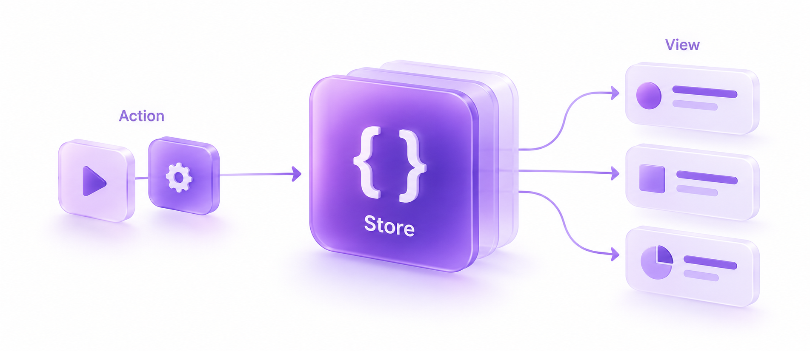

# Store

[Русский](README.ru.md)



Store helps you keep shared game data in one place and let other parts of your game know when it changes.

For example, a player earns 10 points. You send an action to Store, a reducer calculates the new score, and Store calls the code that displays it. That code can update a UI label, play an animation, or simply print the score.

This is useful when several parts of your game need the same data, such as score, coins, player health, or settings. Store itself has no Unity Engine or third-party dependencies.

## How it works

There are five small pieces to get familiar with:

| Term | What it means | In the example below |
| --- | --- | --- |
| **State** | The data you want to keep together. | `GameState` holds the score. |
| **Action** | A message describing a change you want to make. | `IncrementScoreAction(Amount: 10)` asks to add 10 points. |
| **Reducer** | A function that takes the current state and an action, then returns the next state. | `Reduce` adds the requested number of points. |
| **Store** | The object that holds the current state and passes actions to the reducer. | `store.Dispatch(...)` sends an action. |
| **Subscription** | A callback you ask Store to run when a value changes. | `Subscribe` lets us print the score. |

The usual flow is:

`Send an action → Calculate the next state → Store it → Notify interested subscribers`

You write the data, reducer, and callbacks. Store connects them and checks whether values have changed before sending updates.

## Add Store to your project

The package requires **Unity 6.0 (6000.0) or newer**. The examples use **C# 9 records**.

1. Open **Window > Package Manager** in Unity.
2. Choose **+ > Install package from git URL**.
3. Paste this URL and select **Install**:

```text
https://github.com/evg-b/store.git
```

This installs the package from the repository's default branch. You can append `#` followed by an existing tag or full commit hash to keep a fixed version.

If you already have a local copy, choose **Install package from disk** and select its `package.json`. You can also copy the whole package directory into `Packages/io.github.evg-b.store` in your Unity project.

### Enable records in your assembly

We use `sealed record` for state and actions. Unity 6.0 needs a small compatibility type called `IsExternalInit` for these records, as explained in the [Unity C# compiler documentation](https://docs.unity3d.com/6000.0/Documentation/Manual/CSharpCompiler.html).

If your project already makes this type available to your records, you can use the existing one. Otherwise, create a file named `IsExternalInit.cs`:

```csharp
#if !NET5_0_OR_GREATER
namespace System.Runtime.CompilerServices
{
    internal static class IsExternalInit
    {
    }
}
#endif
```

For a project without `.asmdef` files, put it under `Assets/Scripts`, alongside your application code. This also addresses a `CS0518` compiler error mentioning `IsExternalInit`.

If you use `.asmdef` files (Unity assembly definitions), the helper must be available in each assembly that declares records and needs it. An internal helper inside Store's own assembly cannot be used by your application's assembly. Avoid adding a duplicate type where one already exists; .NET 5 and newer provide it themselves.

## Try it in Unity

The included **Counter Store** sample is a good place to start:

1. Select **Store** in Package Manager and import **Counter Store** from **Samples**.
2. Add `CounterStoreExample` to an active GameObject in your scene.
3. Connect a UI Button's **On Click** event to that component's `Increment()` method.
4. Enter Play Mode and open the Console. You should see `Counter State changed: 0`. Press the button to see `1`, then `2`, and so on.

The [sample setup guide](Samples~/CounterStore/README.md) covers the scene and Button setup. The component creates its own Store and stops listening when its GameObject is destroyed.

## A small example to read through

Let's start with a score of zero, listen for changes, and add 10 points.

The example keeps all the pieces together in one file. To run it in a C# console application, call `ScoreExample.Run()` from `Main`. The Unity sample above shows how to connect the same pieces through component methods such as `Awake` and `OnDestroy`.

```csharp
using System;
using Evg.Store;

public sealed record GameState(int Score);
public sealed record IncrementScoreAction(int Amount) : IAction;

public static class ScoreExample
{
    public static void Run()
    {
        IStoreService<GameState> store = new StoreService<GameState>(
            new GameState(Score: 0),
            Reduce
        );

        using (IDisposable subscription = store.Subscribe(
            state => state.Score,
            score => Console.WriteLine(score)))
        {
            store.Dispatch(new IncrementScoreAction(Amount: 10));
        }
    }

    private static GameState Reduce(GameState state, IAction action)
    {
        return action switch
        {
            IncrementScoreAction increment =>
                state with { Score = state.Score + increment.Amount },
            _ => state
        };
    }
}
```

Output:

```text
0
10
```

Here's what happens:

1. `new GameState(Score: 0)` creates our starting data.
2. `new StoreService<GameState>(..., Reduce)` gives Store that data and the function to use for updates.
3. `Subscribe` starts listening to the score. It immediately prints the current value, `0`.
4. `Dispatch(new IncrementScoreAction(Amount: 10))` sends the request to add points. `Reduce` returns a new state with `Score = 10`, so Store calls the subscriber again.
5. Leaving the `using` block stops the subscription.

The expression `state => state.Score` is a **selector**: a small function that picks the part of the state you care about. The second function, `score => Console.WriteLine(score)`, decides what to do with that value.

## Working with your own game

### Create a new state when data changes

A `record` gives our state value equality: two `GameState` records with the same score compare equal. The `with` expression creates a new record with the fields you want to change.

Store compares the reducer's result with the previous state. If they are equal, it keeps the previous state and does not notify subscribers. For an action your reducer does not handle, return the state you received.

Keep reducers focused on calculating the next state. Load files, read the clock, or generate random values outside the reducer, then pass the results in an action.

One detail matters for collections: `with` makes a shallow copy. If your state contains a list or dictionary, copy that collection before changing it. Earlier states must keep their original data. The [collection example](Documentation~/index.md#collections-and-records) shows how.

### Listen to the value your UI needs

For a score label, select `state => state.Score`. Store immediately sends its current value, then calls your listener when that score changes. A change to an unrelated field does not need to refresh the label.

You can also use `Subscribe(listener)` to observe the whole state. Custom equality rules for selected values are described in the [API guide](Documentation~/index.md#subscription-lifecycle).

### Stop listening when you are done

`Subscribe` returns an `IDisposable`: an object that represents your subscription. Call its `Dispose()` method when you want to stop receiving future state updates.

In a Unity component, keep that token in a field and call `Dispose()` from `OnDestroy`. The Counter Store sample does exactly this. The `using` block in the console example handles the same cleanup automatically.

## A few useful details

- **Reading and loading data.** `GetStore()` returns the current state. Use `SetStore(state)` to pass in data you have loaded from a save before subscribing: it replaces the state without notifying listeners. Use actions for later updates that your UI needs to receive.
- **Where callbacks run.** Dispatch and subscription callbacks run immediately on the calling thread. In Unity, use the main thread when listeners access Unity APIs. Store does not coordinate simultaneous calls from different threads.
- **When your code throws.** Reducer and callback exceptions reach the caller. A callback error can stop the remaining notifications, and a state update already committed by Store is not rolled back. The [API guide](Documentation~/index.md#exceptions) explains the details.

## Learn more

- [API guide, equality rules, and collection example](Documentation~/index.md)
- [Counter Store setup guide](Samples~/CounterStore/README.md)
- [Validation results and checks still needed in Unity](Documentation~/validation.md)

NUnit tests are included in `Tests/Editor`. The validation report explains which checks ran outside Unity and which Editor scenarios still need to be verified.

## License

[MIT](LICENSE.md) © 2026 evg-b.
