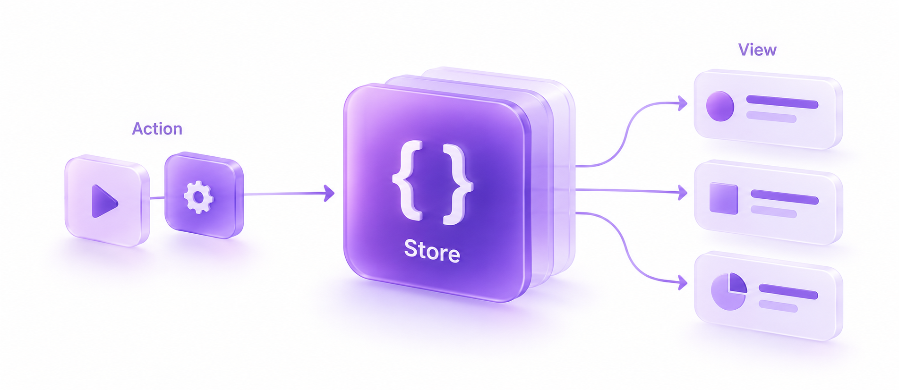

# Store

[English](README.md)



Store помогает хранить общие данные игры в одном месте и сообщать другим частям игры, когда эти данные меняются.

Например, игрок заработал 10 очков. Вы отправляете действие в Store, редьюсер вычисляет новый счёт, а Store вызывает код, который его показывает. Этот код может обновить текст в UI, запустить анимацию или просто вывести счёт в консоль.

Такой подход удобен, когда одни и те же данные нужны нескольким частям игры: счёт, монеты, здоровье игрока или настройки. Сам Store не зависит от Unity Engine и сторонних библиотек.

## Как это работает

Для начала познакомимся с пятью понятиями:

| Понятие | Что это значит | В примере ниже |
| --- | --- | --- |
| **State — состояние** | Данные, которые вы хотите хранить вместе. | `GameState` хранит счёт. |
| **Action — действие** | Сообщение о том, какое изменение вы хотите сделать. | `IncrementScoreAction(Amount: 10)` просит добавить 10 очков. |
| **Reducer — редьюсер** | Функция, которая получает текущее состояние и действие, затем возвращает следующее состояние. | `Reduce` прибавляет нужное количество очков. |
| **Store — хранилище** | Объект, который хранит текущее состояние и передаёт действия редьюсеру. | `store.Dispatch(...)` отправляет действие. |
| **Subscription — подписка** | Обработчик, который вы просите Store вызвать при изменении значения. | `Subscribe` позволяет выводить счёт. |

Обычный путь обновления выглядит так:

`Отправляем действие → Вычисляем новое состояние → Сохраняем его в Store → Уведомляем подписчиков`

Вы описываете данные, редьюсер и обработчики. Store связывает их и проверяет, изменились ли значения, прежде чем отправлять обновления.

## Добавьте Store в проект

Пакету требуется **Unity 6.0 (6000.0) или новее**. Примеры используют **records из C# 9**.

1. Откройте **Window > Package Manager** в Unity.
2. Выберите **+ > Install package from git URL**.
3. Вставьте этот адрес и нажмите **Install**:

```text
https://github.com/evg-b/store.git
```

Так устанавливается пакет из основной ветки репозитория. Чтобы зафиксировать версию, можно дописать `#` и существующий тег или полный хеш коммита.

Если у вас уже есть локальная копия, выберите **Install package from disk** и укажите её `package.json`. Другой вариант — скопировать каталог пакета целиком в `Packages/io.github.evg-b.store` вашего Unity-проекта.

### Поддержка records в вашей сборке

Для состояния и действий мы используем `sealed record`. В Unity 6.0 для этих records нужен небольшой совместимый тип `IsExternalInit` — это описано в [документации компилятора Unity](https://docs.unity3d.com/6000.0/Documentation/Manual/CSharpCompiler.html).

Если этот тип уже доступен вашим records, используйте существующий. Иначе создайте файл `IsExternalInit.cs`:

```csharp
#if !NET5_0_OR_GREATER
namespace System.Runtime.CompilerServices
{
    internal static class IsExternalInit
    {
    }
}
#endif
```

В проекте без `.asmdef` положите его в `Assets/Scripts`, рядом с кодом приложения. Это также устраняет ошибку компилятора `CS0518` с упоминанием `IsExternalInit`.

Если вы используете `.asmdef` — файлы определения сборок Unity, — вспомогательный тип должен быть доступен в каждой сборке, которая объявляет records и нуждается в нём. Внутренний тип только в сборке Store недоступен сборке вашего приложения. Не добавляйте дубликат там, где такой тип уже есть; в .NET 5 и новее он встроен.

## Попробуйте в Unity

Начать удобно с готового примера **Counter Store**:

1. Выберите **Store** в Package Manager и импортируйте **Counter Store** из раздела **Samples**.
2. Добавьте `CounterStoreExample` на активный GameObject в сцене.
3. Привяжите событие **On Click** кнопки UI к методу `Increment()` этого компонента.
4. Войдите в Play Mode и откройте Console. Вы должны увидеть `Counter State changed: 0`. Нажимайте кнопку: появятся `1`, затем `2` и так далее.

В [инструкции примера](Samples~/CounterStore/README.md) описана настройка сцены и кнопки. Компонент создаёт собственный Store и освобождает подписку при уничтожении своего GameObject.

## Небольшой пример с пояснениями

Начнём со счёта, равного нулю, подпишемся на его изменения и добавим 10 очков.

Все части собраны в одном файле. Для запуска в консольном C#-приложении вызовите `ScoreExample.Run()` из `Main`. Пример для Unity выше показывает, как связать те же части через методы компонента, такие как `Awake` и `OnDestroy`.

```csharp
using System;
using Evg.Store;

public sealed record GameState(int Score);
public sealed record IncrementScoreAction(int Amount) : IAction;

public static class ScoreExample
{
    public static void Run()
    {
        IStoreService<GameState> store = new StoreService<GameState>(
            new GameState(Score: 0),
            Reduce
        );

        using (IDisposable subscription = store.Subscribe(
            state => state.Score,
            score => Console.WriteLine(score)))
        {
            store.Dispatch(new IncrementScoreAction(Amount: 10));
        }
    }

    private static GameState Reduce(GameState state, IAction action)
    {
        return action switch
        {
            IncrementScoreAction increment =>
                state with { Score = state.Score + increment.Amount },
            _ => state
        };
    }
}
```

Результат:

```text
0
10
```

Что здесь происходит:

1. `new GameState(Score: 0)` создаёт начальные данные.
2. `new StoreService<GameState>(..., Reduce)` передаёт Store эти данные и функцию для обновлений.
3. `Subscribe` начинает следить за счётом. Подписчик сразу получает текущее значение и выводит `0`.
4. `Dispatch(new IncrementScoreAction(Amount: 10))` отправляет просьбу добавить очки. `Reduce` возвращает новое состояние с `Score = 10`, и Store снова вызывает подписчика.
5. При выходе из блока `using` подписка освобождается.

Выражение `state => state.Score` — это **селектор**: небольшая функция, которая выбирает нужную часть состояния. Вторая функция, `score => Console.WriteLine(score)`, определяет, что делать с полученным значением.

## Как применить это в своей игре

### Создавайте новое состояние при изменении данных

`record` даёт состоянию равенство по значениям: два `GameState` с одинаковым счётом считаются равными. Выражение `with` создаёт новый record с теми полями, которые вы хотите изменить.

Store сравнивает результат редьюсера с предыдущим состоянием. Если они равны, он сохраняет прежнее состояние и не уведомляет подписчиков. Если редьюсер не обрабатывает действие, верните полученное состояние.

Пусть редьюсер занимается вычислением следующего состояния. Загружайте файлы, читайте время или получайте случайные значения снаружи, а результаты передавайте в действии.

Для коллекций есть важная деталь: `with` создаёт поверхностную копию. Если в состоянии есть список или словарь, скопируйте коллекцию перед изменением. Данные в прежних состояниях должны сохраниться. В [примере с коллекцией](Documentation~/index.md#collections-and-records) показано, как это сделать.

### Следите за значением, которое нужно вашему UI

Для текста со счётом выберите `state => state.Score`. Store сразу передаст текущее значение, а затем будет вызывать обработчик при изменении счёта. Изменение другого поля не потребует обновлять этот текст.

Через `Subscribe(listener)` можно следить за состоянием целиком. Собственные правила сравнения выбранных значений описаны в [руководстве по API](Documentation~/index.md#subscription-lifecycle).

### Освобождайте подписку, когда она больше не нужна

`Subscribe` возвращает `IDisposable` — объект вашей подписки. Вызовите его метод `Dispose()`, когда захотите перестать получать последующие обновления состояния.

В компоненте Unity сохраните подписку в поле и вызовите `Dispose()` из `OnDestroy`. Именно так устроен Counter Store. В консольном примере блок `using` выполняет то же освобождение автоматически.

## Ещё несколько полезных деталей

- **Чтение и загрузка данных.** `GetStore()` возвращает текущее состояние. Через `SetStore(state)` передайте данные, которые вы загрузили из сохранения, до создания подписок: этот метод заменяет состояние без уведомления обработчиков. Последующие обновления, которые должен получить UI, отправляйте через Actions.
- **Где выполняются обработчики.** Dispatch и обработчики подписок выполняются сразу в вызывающем потоке. В Unity используйте главный поток, если обработчики обращаются к Unity API. Store не управляет одновременными вызовами из разных потоков.
- **Если ваш код выбросил исключение.** Исключение редьюсера или обработчика передаётся вызывающему коду. Ошибка обработчика может прервать оставшиеся уведомления; уже сохранённое в Store обновление не откатывается. Подробности есть в [руководстве по API](Documentation~/index.md#exceptions).

## Что почитать дальше

- [Руководство по API, сравнение значений и пример с коллекцией](Documentation~/index.md)
- [Инструкция по запуску Counter Store](Samples~/CounterStore/README.md)
- [Результаты проверок и сценарии, которые ещё нужно проверить в Unity](Documentation~/validation.md)

NUnit-тесты находятся в `Tests/Editor`. В отчёте указано, какие проверки выполнены вне Unity и какие сценарии в Editor ещё требуют проверки.

## Лицензия

[MIT](LICENSE.md) © 2026 evg-b.
